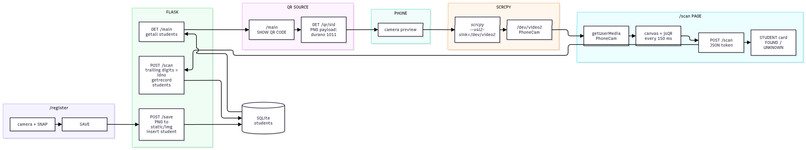

IT-ELPYTHON 3Y-1S | Simple Attendance System with QR Scanner

## Stack

- python
- venv
- flask
- sqlite3
- w3.css
- [scrcpy](https://github.com/genymobile/scrcpy)
- [jsqr](https://github.com/cozmo/jsqr)
- [android-tools](https://software.opensuse.org/package/android-tools)
- [ffmpeg](https://software.opensuse.org/package/ffmpeg)
- [v4l2loopback-kmp-default](https://software.opensuse.org/package/v4l2loopback-kmp-default)

##  ~~Webcam~~ Android as a scanner.

```text
android-tools (connect android to scrcpy via adb)
               ↓
scrcpy (read android camera, then write frames to virtual cam)
               ↓
v4l2loopback-kmp-default (virtual cam)
               ↓
ffmpeg (play frames from virtual cam)
```

## Visual Flow



> *c: [jul](https://github.com/worriee)*
