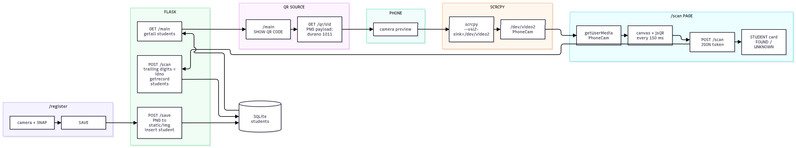
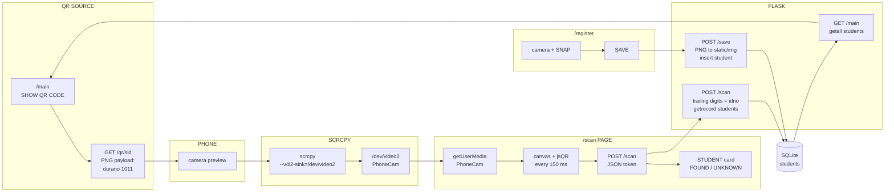

# Python Finals — Project Stack, Flow, and Camera Setup

## 1. What this app does

This is a Flask + SQLite student list. `/main` shows every student in a table, and
the `/add`, `/update/<id>`, and `/delete/<id>` routes edit that list.

`/register` captures a photo from a camera and adds a new student. The app saves the
photo to `static/img/<idno>.png` and stores the path with the student row.

`/scan` reads a QR code from a camera feed and shows that student's details. It
looks the student up and returns their fields. It records nothing.

## 2. The map





QR SOURCE is where a student's QR code comes from. `/main` shows a QR code button,
and `GET /qr/<id>` returns a PNG whose readable payload is `durano 1011` style text,
not a random token.

PHONE is the phone's camera preview. The phone never talks to the Flask app directly.

SCRCPY is the bridge from the phone to Linux. `scrcpy` reads the phone camera and
writes frames into `/dev/video2`, which is labeled PhoneCam.

/scan PAGE is the browser scanner. It opens the PhoneCam device, samples the canvas
every 150 ms with jsQR, POSTs the decoded text to `/scan`, and shows a STUDENT card
with FOUND or UNKNOWN.

FLASK is the backend. `POST /scan` strips the text, extracts trailing digits as the
idno, looks up the student, and returns the fields. `POST /save` stores the uploaded
PNG and inserts the student. `GET /main` returns all students.

/register is the add-student page. `camera + SNAP` draws the live video into a canvas
and produces a PNG blob. `SAVE` POSTs that blob and the form fields to `/save`.

The SQLite students database holds the student rows and is the single source of truth
for lookups and the student table.

## 3. Stack table

| Layer | Technology | Version | Job |
|---|---|---|---|
| Web framework | Flask | 3.1.3 | routes, templates, JSON, file responses |
| Templates | Jinja2 | 3.1.6 | HTML rendering, blocks, loops |
| WSGI / dev server | Werkzeug | 3.1.9 | request parsing, multipart upload, reload |
| Database | SQLite3 (Python stdlib) | bundled with 3.13 | `db/school.db` |
| QR generation | qrcode | 8.2 | PNG bytes for `/qr/<id>` |
| Image backend | pillow | 13.0.0 | required by qrcode |
| Styling | W3.CSS | 6.04 Beta | local CSS, no build |
| QR decoding | jsQR | local copy | decode frames in the browser |
| Camera capture | browser `getUserMedia` | native | read the webcam device |
| Phone camera bridge | scrcpy | 5.0.1 | phone frames into a virtual camera |
| Virtual camera | v4l2loopback | 0.15.4 | creates `/dev/video2` |
| Device tooling | v4l-utils, psmisc, ffmpeg | see versions above | inspect and test the feed |

## 4. Python packages, one by one

| Package | Version | What it does | Where used | Direct or dependency |
|---|---|---|---|---|
| Flask | 3.1.3 | app routes, `render_template`, `jsonify`, `send_file`, `request` | `app.py` | direct |
| Jinja2 | 3.1.6 | ``, ``, loops over `students` | `templates/*.html` | direct (via Flask) |
| Werkzeug | 3.1.9 | dev server, `request.files` multipart parsing, request routing | `app.py` runtime | direct (via Flask) |
| MarkupSafe | 3.0.4 | template string escaping for Jinja2 | Jinja2 runtime | dependency |
| itsdangerous | 2.2.0 | signing helpers used by Flask internals | Flask dependency | dependency |
| click | 8.5.1 | CLI helpers used by Flask/Werkzeug | Flask dependency | dependency |
| blinker | 1.9.0 | signal helpers used by Flask internals | Flask dependency | dependency |
| qrcode | 8.2 | builds the QR PNG from a text payload | `app.py` `/qr/<sid>` | direct |
| pillow | 13.0.0 | image writer that qrcode uses to save PNG bytes | qrcode backend | direct dependency of qrcode |

Python stdlib used directly: `sqlite3`, `secrets.token_hex`, `re`, `os`, `io.BytesIO`.

```bash
python3 -m venv venv
venv/bin/pip install flask qrcode pillow
```

## 5. Frontend, one by one

- `static/css/w3.css` — W3.CSS 6.04 Beta, local file, loaded with
  `url_for('static', filename='css/w3.css')`.
- `static/js/jsqr.min.js` — local copy, 256,885 bytes, no version header, loaded
  only by `scan.html`.
- no framework, no bundler, no package.json.

Browser APIs used: `navigator.mediaDevices.getUserMedia`, `enumerateDevices`,
`canvas.getContext('2d')`, `canvas.toBlob`, `fetch`, `FormData`,
`URL.createObjectURL`.

## 6. System packages and why they exist

| Package | Binary it provides | Why the project needs it | What breaks without it |
|---|---|---|---|
| scrcpy | `scrcpy` | reads the phone camera and writes frames to the virtual camera | phone feed never reaches `/dev/video2` |
| android-tools | `adb` | connects to the phone over USB or Wi-Fi | scrcpy cannot see the phone |
| ffmpeg | `ffmpeg` | reads `/dev/video2` to verify real frames | no quick frame test without it |
| v4l2loopback-kmp-default | `v4l2loopback` kernel module | creates the virtual camera device | no `/dev/video2` |
| v4l2loopback-utils | loopback device helpers | supports the virtual camera device | virtual camera setup is incomplete |
| v4l-utils | `v4l2-ctl` | lists and inspects video devices | cannot confirm PhoneCam exists |
| psmisc | `fuser` | shows which process holds `/dev/video2` | cannot tell whether scrcpy is writing frames |
| brave-browser | Brave | one of the browsers tested for the camera permission | can still use another browser |
| chromium | `chromium` | another browser that can open the scanner | can still use another browser |

> `/dev/video2` is not the laptop camera. It is a virtual camera created by
> `v4l2loopback`. The laptop camera is `/dev/video0` (`ACER HD User Facing`). The
> browser sees both devices, and `scan.html` picks the one whose label contains
> `PhoneCam`.

The chain is:

1. `scrcpy` reads the phone camera and encodes H.264.
2. `--v4l2-sink=/dev/video2` writes those frames into the loopback device.
3. `v4l2loopback` presents `/dev/video2` to Linux as an ordinary camera.
4. The browser opens it through `getUserMedia`, exactly like a USB webcam.
5. `jsQR` decodes the canvas frames.

No data passes through the network to Flask. The phone never talks to the app.

## 7. Mirroring and orientation

scrcpy does not mirror by default.

A front camera preview on the phone is mirrored because the phone app shows a selfie
view. That is a display choice on the phone, not a change to the stream itself.

If the stream itself is mirrored, fix it at the source with
`--capture-orientation=flip0` (or `flip90`, `flip180`, `flip270`).

Do not fix mirroring with CSS `transform: scaleX(-1)` on the video and a matching
canvas flip. A mirrored QR can fail to decode in jsQR, and preview and captured frames
must stay consistent.

| What you want | Add this flag | Output |
|---|---|---|
| Landscape, normal | *(nothing)* | 1280×720 |
| Landscape, upside down | `--capture-orientation=180` | 1280×720 |
| Landscape, mirrored | `--capture-orientation=flip0` | 1280×720 |
| Landscape, mirrored + upside down | `--capture-orientation=flip180` | 1280×720 |
| Portrait | `--capture-orientation=90` | 720×1280 |
| Portrait, other way | `--capture-orientation=270` | 720×1280 |
| Portrait, mirrored | `--capture-orientation=flip90` | 720×1280 |
| Portrait, mirrored other way | `--capture-orientation=flip270` | 720×1280 |

See `docs/scrcpy-python-finals.md` for deeper scrcpy troubleshooting instead of
duplicating it here.

## 8. Setup commands, from zero

Step 1 — install system packages:

```bash
sudo zypper install scrcpy android-tools ffmpeg \
  v4l2loopback-kmp-default v4l2loopback-utils v4l-utils psmisc
```

Step 2 — persist the virtual camera config:

```bash
echo 'options v4l2loopback video_nr=2 exclusive_caps=1 card_label=PhoneCam' \
  | sudo tee /etc/modprobe.d/v4l2loopback-phonecam.conf
sudo modprobe v4l2loopback
```

Step 3 — verify the device:

```bash
v4l2-ctl --list-devices
```

Step 4 — connect the phone:

```bash
adb devices
adb connect <phone-ip>:5555
```

Step 5 — list cameras and encoders once per phone:

```bash
scrcpy --list-cameras
scrcpy --list-encoders
```

Step 6 — start the virtual camera:

```bash
scrcpy --video-source=camera --camera-size=1280x720 --camera-fps=30 \
       --v4l2-sink=/dev/video2 --no-playback
```

Step 7 — verify frames:

```bash
fuser -v /dev/video2
ffmpeg -f v4l2 -i /dev/video2 -frames:v 1 -y /tmp/frame.jpg
```

Run the ffmpeg test only while the browser is not using the device, because
`exclusive_caps=1` allows one reader.

Step 8 — Python environment:

```bash
python3 -m venv venv
venv/bin/pip install flask qrcode pillow
```

Step 9 — run the app:

```bash
venv/bin/python app.py
```

Step 10 — browser permission:

```
http://127.0.0.1:5000/scan
```

Allow the camera once. Note `127.0.0.1` and `localhost` are different origins for
permissions.

## 9. Scan flow in code

`templates/scan.html`:

- phase 1: `getUserMedia({video:{width:{ideal:1280}}})`
- `enumerateDevices`, find the label containing `PhoneCam`
- phase 2: `getUserMedia({video:{deviceId:{exact:...}}})`, stop the first stream
- `setInterval(tick, 150)`
- `canvas` + `drawImage` + `getImageData` + `jsQR`
- `fetch('/scan', {method:'POST', body: JSON.stringify({token: text})})`
- the response fills `#d_idno`, `#d_lastname`, `#d_firstname`, `#d_course`, `#d_level`
- banner text is `FOUND — lastname, firstname` or `UNKNOWN CODE`
- a 2 second pause via `paused`

`app.py` `/scan`:

- `.strip()`
- `re.match(r'^(.*?)\s*(\d+)$', text)`
- trailing digits become `idno`
- `getrecord('students', idno=idno)`
- not found: `{ok:false, status:'unknown'}`
- found: `{ok:true, idno, lastname, firstname, course, level}`
- no database write anywhere

## 10. QR generation

- `app.py` `/qr/<int:sid>`
- payload `f"{(lastname or '').lower()} {idno}"`
- `qrcode.make(payload).save(buf, format='PNG')`
- returned with `send_file`, filename `qr-<idno>.png`
- `main.html` `showqrcode()` puts it in the modal

The payload contains the name so a phone camera shows readable text instead of random
characters.

## 11. Register flow

`register.html`:

- camera, `SNAP` draws the video into a canvas
- `canvas.toBlob(..., 'image/png')`
- `save_info()` builds `FormData`, appends `webcam`, `idno`, `lastname`, `firstname`,
  `course`, `level`
- `fetch('/save', {method:'POST', body: fd})`

`app.py` `/save`:

- saves `static/img/<idno>.png`
- inserts the student with the `image` path
- duplicate idno returns `409`
- success alert is `New Student Added`

## 12. Database

`students` columns: id, idno, lastname, firstname, course, level, token, image.

The `attendance` table was dropped. The scanner is a viewer, not a recorder.
`/mark` and `/attendance` no longer exist.

## 13. Routes

| Route | Method | Job |
|---|---|---|
| `/` | GET | redirect to `/main` |
| `/main` | GET | student table |
| `/add` | POST | insert student |
| `/update/<id>` | POST | edit student |
| `/delete/<id>` | POST | delete student |
| `/register` | GET | registration page |
| `/save` | POST | photo + insert from register |
| `/scan` | GET | scanner page |
| `/scan` | POST | JSON lookup |

## 14. Troubleshooting

| Symptom | Cause | Fix |
|---|---|---|
| `IllegalArgumentException` / `Demuxer error` | default camera size too large for the encoder | keep `--camera-size=1280x720` |
| `CAM ERROR: check browser permissions` | browser denied camera | allow in site settings |
| `CAM ERROR: scrcpy issue` | `/dev/video2` exists, nothing writes to it | start scrcpy with `--v4l2-sink` |
| `CAM ERROR: device cam issue` | no camera or device cannot open | `v4l2-ctl --list-devices`, restart scrcpy |
| `UNKNOWN CODE` | QR text has no matching idno | scan a QR from `/qr/<id>` |
| video blank, `fuser` empty | scrcpy exited or phone disconnected | rerun scrcpy, check `adb devices` |
| `ffmpeg` hangs on `/dev/video2` | no writer attached | start scrcpy first |

## 15. Study checklist

1. Why does the browser not need the phone's IP address?
   Because scrcpy writes the phone frames into `/dev/video2`, and the browser reads
   that local virtual camera.
2. What does `exclusive_caps=1` change?
   It lets only one process read `/dev/video2` at a time.
3. Why is the QR payload `durano 1011` and not the token?
   So the phone shows readable text, not random characters.
4. What happens if scrcpy is stopped while `/scan` is open?
   The scanner falls back to another camera, and PhoneCam disappears from the device
   list.
5. Why is the canvas needed if the video element already shows the picture?
   jsQR decodes raw pixel data from the canvas, not from the video element.
6. Why does `/scan` not reload the page anymore?
   The JS fetches `/scan` as JSON and fills the student card in place.
7. Where is the uploaded photo stored, and what is stored in the database?
   The photo is stored in `static/img/<idno>.png`, and the database stores that path.
8. Which package turns the QR payload into an image?
   `qrcode`, with pillow as its image backend.
9. Which layer decides that a decoded text belongs to a student?
   `app.py` `/scan`, by extracting the trailing digits and looking up the student.
10. What would break if `jsqr.min.js` were loaded from a CDN?
   The scanner would depend on an external host, and the project's offline/local setup
   would no longer be self-contained.
